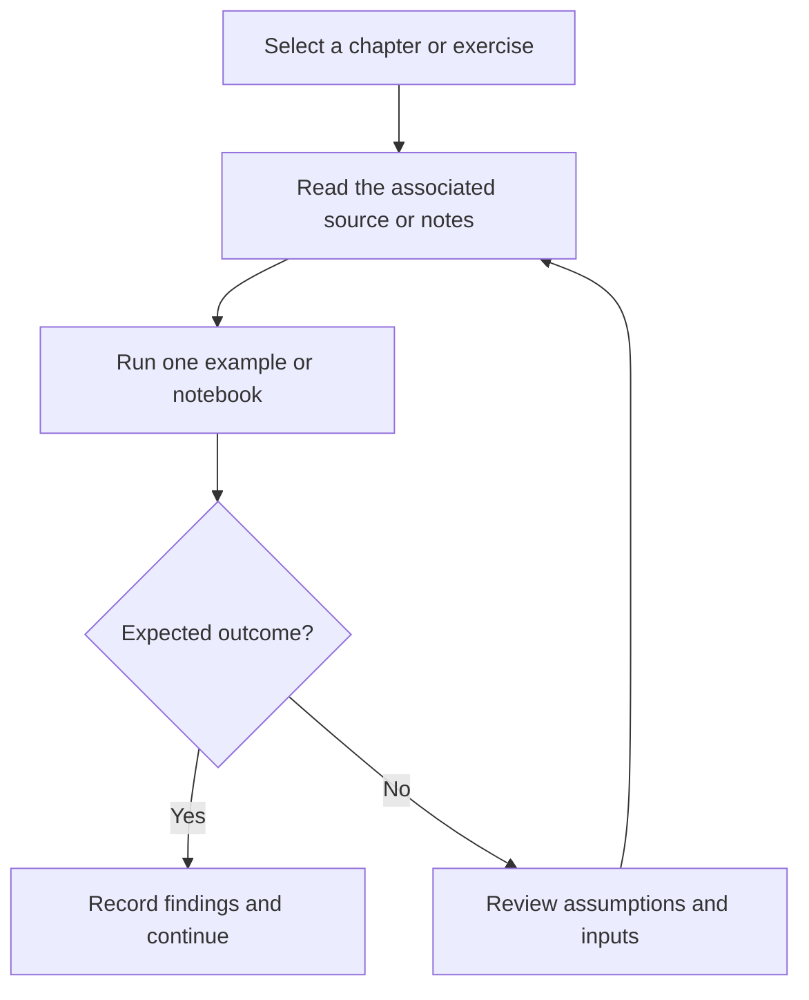

# Voice Cloning — Deep Learning Notebook

Notebook-based deep-learning experiment for voice cloning, accompanied by project notes.

## Project focus

Machine-learning experiment. Use the directory map to choose a focused example or learning topic instead of treating the repository as one application.

## Workflow



## Repository structure

| Path | Purpose |
| --- | --- |
| [`Voice_Cloning.ipynb`](Voice_Cloning.ipynb) | Interactive notebook; inspect its data and dependency setup before execution. |

## Getting started

```bash
git clone https://github.com/Raimal-Raja/Voice_Cloning_DeepLearning_Model.git
cd Voice_Cloning_DeepLearning_Model
```

```bash
python -m venv .venv
source .venv/bin/activate
```

On Windows PowerShell, activate the environment with `.venv\Scripts\Activate.ps1` instead.

Open one `.ipynb` file in Jupyter, VS Code, Kaggle, or Colab. Read its dependency and dataset cells before execution. Notebook paths and model/data requirements vary; this repository is not one shared deployable application.

## Configuration and scope

The notebook is an experiment, not a packaged inference service. Inspect its model, audio-data, and runtime setup cells before execution; training and output quality are not revalidated by this documentation update.

## Verification

Use the setup commands and inspect the selected interface, example, or notebook with known inputs. This documentation review checks repository paths and dependency declarations; it does not claim fresh end-to-end execution or model-quality measurements.

## Contributing

Include reproduction steps, the affected path, expected behavior, and the checks you ran. Keep credentials, generated environments, and unnecessary build artifacts out of commits.

## License

No top-level license file is currently tracked. Check reuse permissions with the repository owner.
